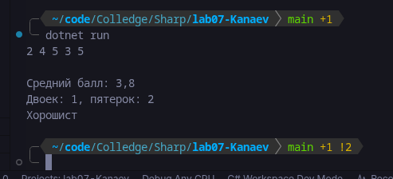
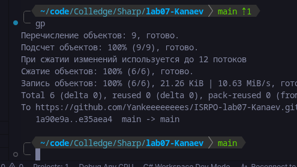

# Практическая работа №7
**ФИО:**
**Группа:**
**Дата:**
## Что изучено

- хранить набор однотипных значений в одном массиве;
- получать и изменять элементы по индексу;
- перебирать массив через for и foreach;
- решать типовые задачи: сумма, среднее, минимум/максимум, подсчёт по
условию.

